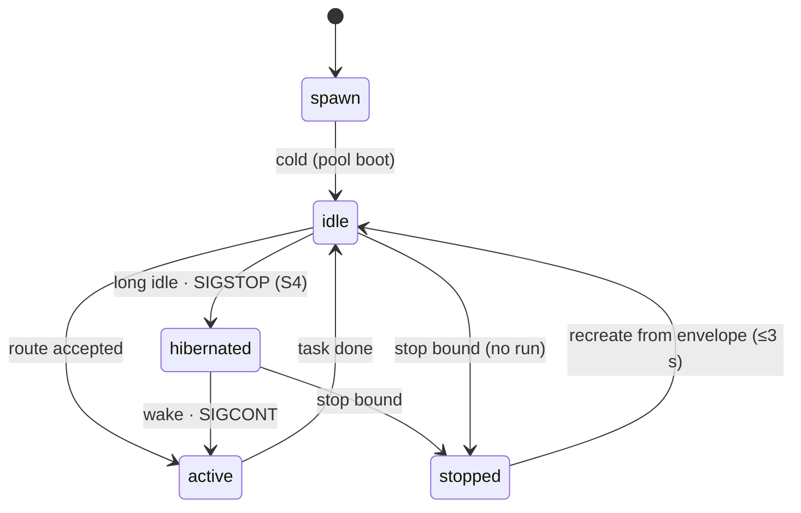

Agents on the mesh are **standing** — registered, long-lived members of a team
— but their processes are individually **ephemeral**: pods churn, idle agents
park, wakes respawn. The lifecycle state machine makes every transition
explicit and replayable from the mesh's point of view.

## States

The gauge vocabulary is fixed at four states: `active`, `idle`, `hibernated`,
`stopped`. Stopped slots stay counted — they are recreate-on-demand capacity,
not a leak. `spawn` is the entry path, not a gauge state: a fresh spawn lands
in `idle` (routable immediately), and the two spawn sources are `cold` (pool
boot) and `envelope` (recreate).

## Hibernation (S4)

A long-idle agent is parked with SIGSTOP and its RAM is reclaimed. This is the
mesh's cheapest resource lever: standing readiness without resident cost.

## Wake

A hibernated agent is woken with SIGCONT when a route selects it
(`RouteEvent{Selection=wake}`). One trade-off matters: if the agent's model
moved while it slept, the wake **respawns from the current envelope** — the
model rebinds at wake, never mid-stream. Such a rebind wake reports zero
`WakeEvent.Duration` (its cost is the respawn, already reported as a spawn
with `Source=envelope`).

## The recreate SLO

When no process exists for a route (hibernate-miss or churn), the gateway
rebuilds one from the pool's envelope — the **recreate** path — inside a
≤3 s arrival→ready window. Spawn sources are a two-value set: `cold` (pool
boot) and `envelope` (recreate).

## Identity survives churn

Recreate means rebuild **without losing identity**: the endpoint id, the
registration, and the memory references come back with the process. That is
what makes standing agents compatible with pod churn — and what the temporal
memory contract builds on.

## Observing it

Every transition the mesh cares about is observable through the
lifecycle-event contract — see [Telemetry](/concepts/telemetry/).
