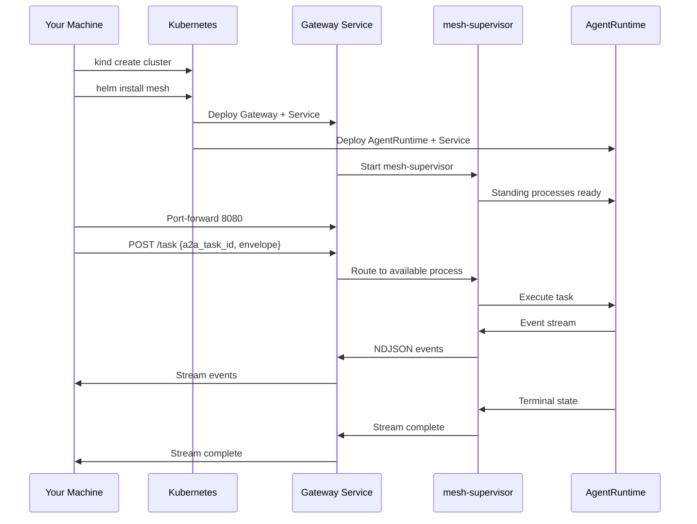
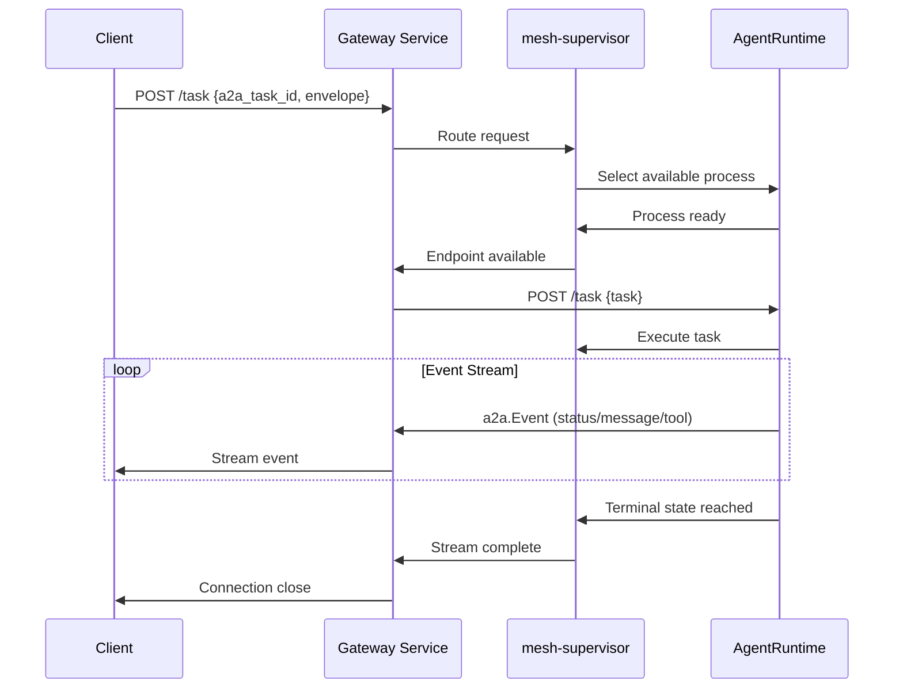

This is the end-to-end "zero host project" path: a fresh [`kind`](https://kind.sigs.k8s.io/)
cluster, a `helm install` of the vanilla chart shipped in `deploy/helm/k8sagentmesh`,
and a first `/task` NDJSON round-trip against the supervisor. No
k8squad chart, no k8squad values, no control-plane of any host project is involved —
that independence is the whole point of this quickstart (plan decision D3).

> **Scope note.** The chart carries **no `dependencies:` block and no vendored
> subcharts** — `helm install` pulls nothing from any host project. You can confirm
> this yourself before installing anything: see [Prove independence](#prove-independence-offline).

See [Prerequisites & troubleshooting](/docs/prerequisites/) for system
requirements, supported platforms, and common fixes.

## What You'll Build

In this quickstart, you'll deploy a standalone K8sAgentMesh instance and execute
your first task through the A2A wire protocol. This demonstrates the mesh's
independence from any host platform while providing full functionality.

### Architecture Overview



## Prerequisites

| Tool | Version | Purpose |
|---|---|---|
| `docker` (or podman) | 20.10+ | Container runtime for kind |
| `kind` | ≥ 0.20 | Kubernetes in Docker clusters |
| `helm` | ≥ 3.12 | Kubernetes package manager |
| `kubectl` | ≥ 1.29 | Kubernetes CLI |

### Required Images

The chart references four Docker images that must be available to your cluster:

| Image | Purpose |
|---|---|
| `ghcr.io/k8sagentmesh/mesh-gateway` | HTTP gateway + mesh-supervisor |
| `ghcr.io/k8sagentmesh/agentruntime` | Task execution runtime |
| `ghcr.io/k8sagentmesh/toolchain-vibe` | Vibe toolchain for agent execution |
| `ghcr.io/k8sagentmesh/toolchain-codex` | Codex toolchain for agent execution |

### Setup Images

Since these images aren't published to GHCR yet, build them locally and load
them into kind:

```sh
# from the repo root — build all required images
for img in mesh-gateway agentruntime toolchain-vibe toolchain-codex; do
  echo "Building $img..."
  docker build -f images/Dockerfile.$img -t ghcr.io/k8sagentmesh/$img:0.1.0 .
  echo "Loading $img into kind..."
  kind load docker-image ghcr.io/k8sagentmesh/$img:0.1.0 --name mesh-qs
done
```

**Note:** Image tags default to the chart's `appVersion`. Adjust the `0.1.0`
tag if you're building a different version.

### Quickstart Script

For convenience, you can use this one-liner to prepare all images:

```sh
# Build and load all required images
for img in mesh-gateway agentruntime toolchain-vibe toolchain-codex; do docker build -f images/Dockerfile.$img -t ghcr.io/k8sagentmesh/$img:0.1.0 . && kind load docker-image ghcr.io/k8sagentmesh/$img:0.1.0 --name mesh-qs; done
```

## 1. Create a fresh kind cluster

Create a dedicated kind cluster for this quickstart. Using a unique name prevents conflicts with existing clusters:

```sh
# Create the cluster
kind create cluster --name mesh-qs

# Verify cluster is ready
kubectl cluster-info --context kind-mesh-qs

# Check node status (should show 1 control-plane node)
kubectl get nodes -o wide
```

**Expected output:**
```
NAME          STATUS   ROLES           AGE   VERSION   INTERNAL-IP   EXTERNAL-IP   OS-IMAGE         KERNEL-VERSION   CONTAINER-RUNTIME
mesh-qs-control-plane   Ready    control-plane   15s   v1.29.0   172.18.0.2    <none>        Kindest Node     5.15.0-102-generic   containerd://1.6.8
```

## 2. Install the vanilla chart

Install the K8sAgentMesh chart with default configuration:

```sh
# Install the chart
helm install mesh ./deploy/helm/k8sagentmesh \
  --namespace mesh --create-namespace \
  --wait

# Wait for all pods to be ready
kubectl wait --namespace mesh \
  --for=condition=ready pod \
  --selector=app.kubernetes.io/name=k8sagentmesh \
  --timeout=300s
```

### Verify Installation

Confirm the release is vanilla and pulled no host-project dependencies:

```sh
# List the release
helm list -n mesh
# Expected output:
# NAME  NAMESPACE  REVISION  STATUS    CHART               APP VERSION
# mesh  mesh       1         deployed  k8sagentmesh-0.2.0  0.1.0

# Check for any host project references
helm get all mesh -n mesh | grep -i k8squad || echo "OK: no k8squad dependencies found"

# Check installed resources
kubectl get all -n mesh
```

**Expected Resources:**

| Resource | Type | Purpose |
|---|---|---|
| `k8sagentmesh-gateway` | Deployment + Service | Standing process manager |
| `k8sagentmesh-agentruntime` | Deployment + Service | Task execution runtime |
| `k8sagentmesh` | ServiceAccount | RBAC for mesh resources |
| `meshpools.mesh.k8sagentmesh.io` | CustomResourceDefinition | Process pool definitions |
| `meshroutes.mesh.k8sagentmesh.io` | CustomResourceDefinition | Routing strategy definitions |
| `meshtelemetries.mesh.k8sagentmesh.io` | CustomResourceDefinition | Telemetry configuration |

**No host project components should be present** - this proves the mesh's
independence.

## 3. First `/task` NDJSON round-trip

The supervisor serves the A2A `/task` contract as a newline-delimited JSON
stream: one `a2a.Event` per line, the stream closing exactly once when the
task reaches a **terminal** state.

### Port-forward Services

Port-forward the gateway service to access the mesh from your local machine:

```sh
# Gateway service (routes through standing band)
kubectl -n mesh port-forward svc/k8sagentmesh-gateway 8080:8080 &

# Alternative: AgentRuntime service (direct ingest)
# kubectl -n mesh port-forward svc/k8sagentmesh-agentruntime 8081:8081 &
```

### Execute Your First Task

Send a task request to the gateway:

```sh
curl -N -s \
  -H 'Content-Type: application/json' \
  -H 'Accept: application/x-ndjson' \
  -d '{
    "a2a_task_id": "quickstart-1",
    "envelope": {
      "input": "Say hello and explain what you are"
    }
  }' \
  http://127.0.0.1:8080/task
```

**Understanding the Response:**

Each line in the response is an `a2a.Event` with the following structure:

```jsonc
{"seq":1,"a2a_task_id":"quickstart-1","type":"status","payload":{"state":"working"}}
{"seq":2,"a2a_task_id":"quickstart-1","type":"message","payload":{"content":"Hello! I am an AI coding agent..."}}
{"seq":3,"a2a_task_id":"quickstart-1","type":"status","payload":{"state":"completed"}}
```

### The Settle Contract

A well-behaved client should:

1. **Read continuously** until receiving a terminal state
2. **Handle stream closure** as a transport failure if no terminal state was received
3. **Check for terminal states**: `completed`, `failed`, or `canceled`

**Terminal States:**
- `completed` - Task finished successfully
- `failed` - Task encountered an error
- `canceled` - Task was canceled externally

### Task Flow Visualization



### Example Successful Task

```jsonc
{"seq":1,"a2a_task_id":"quickstart-1","type":"status","payload":{"state":"working"}}
{"seq":2,"a2a_task_id":"quickstart-1","type":"message","payload":{"content":"Hello! I'm an AI coding agent running on K8sAgentMesh. I can help you with various coding tasks using different toolchains."}}
{"seq":3,"a2a_task_id":"quickstart-1","type":"status","payload":{"state":"completed"}}
```

### Handling Errors

If something goes wrong, you'll see error events:

```jsonc
{"seq":1,"a2a_task_id":"quickstart-2","type":"status","payload":{"state":"working"}}
{"seq":2,"a2a_task_id":"quickstart-2","type":"message","payload":{"content":"Error: Something went wrong"}}
{"seq":3,"a2a_task_id":"quickstart-2","type":"status","payload":{"state":"failed"}}
```

## 4. Verify Independence

### Prove Independence (Offline)

You don't need a cluster to prove the chart has zero host-project coupling:

```sh
# Chart should pass linting with 0 failures
helm lint deploy/helm/k8sagentmesh

# Template should contain no host project references
helm template test deploy/helm/k8sagentmesh | grep -i k8squad || echo "OK: no k8squad references found"

# Chart.yaml should have no dependencies block
grep -n 'dependencies' deploy/helm/k8sagentmesh/Chart.yaml || echo "OK: no dependencies section found"

# No charts/ directory should exist
ls deploy/helm/k8sagentmesh/charts 2>/dev/null || echo "OK: no subcharts directory"

# Check for any Chart.lock file (should not exist)
ls deploy/helm/k8sagentmesh/Chart.lock 2>/dev/null || echo "OK: no Chart.lock file"
```

**Expected Result:**
- No `dependencies:` section in `Chart.yaml`
- No `charts/` subdirectory
- No host project references in templated YAML
- No `Chart.lock` file

This proves the chart is completely independent and resolves only its own resources.

## 5. Verify Mesh Resources

Check that the mesh components are running correctly:

```sh
# Check pod status
kubectl get pods -n mesh

# Expected pods:
# NAME                                        READY   STATUS    RESTARTS   AGE
# k8sagentmesh-agentruntime-xxxxx             1/1     Running   0          2m
# k8sagentmesh-gateway-xxxxx                 1/1     Running   0          2m

# Check service endpoints
kubectl get endpoints -n mesh

# Check CRDs are registered
kubectl get crd | grep mesh.k8sagentmesh.io

# Check mesh events
kubectl get events -n mesh --sort-by='.metadata.creationTimestamp'
```

## Troubleshooting

### Common Issues

#### Pod Not Starting
**Problem:** Pods are in `CrashLoopBackOff` or `ImagePullBackOff` state

**Solutions:**
```sh
# Check pod events
kubectl describe pod -n mesh <pod-name>

# Check image availability (if using local images)
kind load docker-image ghcr.io/k8sagentmesh/<image>:<tag> --name mesh-qs

# Verify Docker build succeeded
docker build -f images/Dockerfile.<image> -t ghcr.io/k8sagentmesh/<image>:<tag> .
```

#### Port-forward Fails
**Problem:** Can't connect to forwarded port

**Solutions:**
```sh
# Check if port-forward is running
ps aux | grep port-forward

# Kill existing port-forward processes
pkill -f "port-forward"

# Restart port-forward
kubectl -n mesh port-forward svc/k8sagentmesh-gateway 8080:8080
```

#### Task Fails Immediately
**Problem:** Tasks return `failed` state immediately

**Solutions:**
```sh
# Check agentruntime logs
kubectl logs -n mesh deployment/k8sagentmesh-agentruntime --tail=20

# Check gateway logs
kubectl logs -n mesh deployment/k8sagentmesh-gateway --tail=20

# Verify task format is correct
curl -X POST -H "Content-Type: application/json" \
  -d '{"a2a_task_id":"test","envelope":{"input":"simple test"}}' \
  http://127.0.0.1:8080/task
```

#### CRD Issues
**Problem:** CRDs not found or working

**Solutions:**
```sh
# Check CRD registration
kubectl get crd | grep mesh.k8sagentmesh.io

# Verify CRD YAML is valid
kubectl apply -f deploy/helm/k8sagentmesh/crds/ --dry-run=client

# Check CRD validation
kubectl explain meshpool
kubectl explain meshroute
kubectl explain meshtelemetry
```

### Debug Commands

#### Detailed Logging
```sh
# Enable verbose logging for mesh components
kubectl set env deployment/k8sagentmesh-gateway LOG_LEVEL=debug -n mesh
kubectl set env deployment/k8sagentmesh-agentruntime LOG_LEVEL=debug -n mesh

# View logs with timestamps
kubectl logs -n mesh deployment/k8sagentmesh-gateway --follow --tail=50 -f
kubectl logs -n mesh deployment/k8sagentmesh-agentruntime --follow --tail=50 -f
```

#### Network Debugging
```sh
# Check service connectivity
kubectl exec -n mesh deployment/k8sagentmesh-agentruntime -- curl http://k8sagentmesh-gateway.mesh.svc.cluster.local:8080/health

# Check pod-to-pod communication
kubectl exec -n mesh deployment/k8sagentmesh-gateway -- nslookup k8sagentmesh-agentruntime.mesh.svc.cluster.local
```

### Getting Help

If you continue to experience issues:

1. **Check GitHub Issues**: Search existing issues in the [K8sAgentMesh repository](https://github.com/K8sAgentMesh/k8sAgentMesh)
2. **Create a New Issue**: Include:
   - Your Kubernetes version (`kubectl version`)
   - Your kind/helm versions
   - Exact error messages and pod logs
   - Steps to reproduce the issue

## Tear Down

Clean up all resources when you are done:

```sh
# Uninstall the release
helm uninstall mesh -n mesh

# Delete the kind cluster
kind delete cluster --name mesh-qs

# Clean up any remaining port-forward processes
pkill -f "port-forward"

# Verify cleanup
kubectl cluster-info --context kind-mesh-qs || echo "OK: cluster deleted successfully"
```

**Congratulations!** You've successfully deployed and tested a standalone
K8sAgentMesh instance, demonstrating its independence from any host platform.

## Next Steps

Now that you have a working mesh, you can:

1. **Explore the CRDs**: Create custom `MeshPool`, `MeshRoute`, and `MeshTelemetry` resources — see [CRD contracts](/concepts/crds/)
2. **Read the architecture**: How the gateway, router, and lifecycle fit — see [Architecture](/concepts/architecture/)
3. **Integrate your platform**: Adapt the mesh for your own Kubernetes environment — see [Host integration](/docs/host-integration/)
4. **Contribute**: Join the development effort and help improve the mesh — see [Contributing](/community/contributing/)
