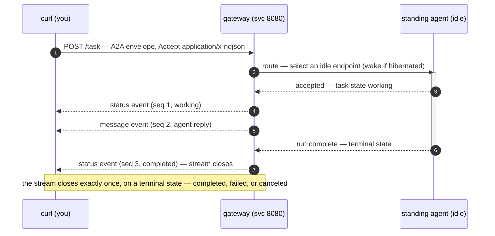

The "zero host project" path: a fresh [`kind`](https://kind.sigs.k8s.io/) cluster,
one `helm install` of the vanilla chart, and a first `/task` NDJSON round-trip.
No host-project chart, values, or control plane is involved — the chart has no
`dependencies:` block and pulls nothing but its own resources.

> Tools, versions, and common fixes: [Prerequisites & troubleshooting](/docs/prerequisites/).

## 0. Build and load the images

From the repo root, build the four images the chart references and load them
into kind (they are not yet on GHCR):

```sh
kind create cluster --name mesh-qs   # skip if you already have a cluster

for img in mesh-gateway agentruntime toolchain-vibe toolchain-codex; do
  docker build -f images/Dockerfile.$img -t ghcr.io/k8sagentmesh/$img:0.1.0 . &&
  kind load docker-image ghcr.io/k8sagentmesh/$img:0.1.0 --name mesh-qs
done
```

## 1. Install the chart

```sh
helm install mesh ./deploy/helm/k8sagentmesh \
  --namespace mesh --create-namespace \
  --wait

kubectl wait --namespace mesh \
  --for=condition=ready pod \
  --selector=app.kubernetes.io/name=k8sagentmesh \
  --timeout=300s
```

You should see the `k8sagentmesh-gateway` and `k8sagentmesh-agentruntime`
deployments go `Running`, plus the three CRDs (`meshpools`, `meshroutes`,
`meshtelemetries` .mesh.k8sagentmesh.io):

```sh
kubectl get pods -n mesh
kubectl get crd | grep mesh.k8sagentmesh.io
```

## 2. Run your first task

The gateway serves the A2A `/task` contract as a newline-delimited JSON stream:
one `a2a.Event` per line, closing exactly once when the task reaches a terminal
state (`completed`, `failed`, or `canceled`).

```sh
kubectl -n mesh port-forward svc/k8sagentmesh-gateway 8080:8080 &

curl -N -s \
  -H 'Content-Type: application/json' \
  -H 'Accept: application/x-ndjson' \
  -d '{
    "a2a_task_id": "quickstart-1",
    "envelope": { "input": "Say hello and explain what you are" }
  }' \
  http://127.0.0.1:8080/task
```

Expected response — status events bracket the message stream:

```jsonc
{"seq":1,"a2a_task_id":"quickstart-1","type":"status","payload":{"state":"working"}}
{"seq":2,"a2a_task_id":"quickstart-1","type":"message","payload":{"content":"Hello! I'm an AI coding agent..."}}
{"seq":3,"a2a_task_id":"quickstart-1","type":"status","payload":{"state":"completed"}}
```

That's the whole loop: **one `POST /task` in, a stream of A2A events out.** If
the stream ends without a terminal state, treat it as a transport failure and
retry.

### The round trip, as a sequence



### Prove the independence

The install above is the mesh alone — no host project attached. Three
one-line proofs from the repo root:

```sh
# 1. the chart is dependency-free: no host chart, no subcharts pulled
grep -A1 '^dependencies:' deploy/helm/k8sagentmesh/Chart.yaml || echo "no dependencies block"

# 2. extraction-clean: no host import anywhere in the module
#    (the same guard runs in CI as hack/extraction-clean.sh)
grep -ri 'k8squad/k8squad' --include='*.go' . || echo "extraction-clean"

# 3. only mesh-group CRDs were applied to your cluster
kubectl api-resources --api-group=mesh.k8sagentmesh.io
```


## 3. Tear down

```sh
helm uninstall mesh -n mesh
kind delete cluster --name mesh-qs
pkill -f "port-forward"
```

## Next steps

1. **Explore the CRDs** — `MeshPool`, `MeshRoute`, `MeshTelemetry`: [CRD contracts](/concepts/crds/)
2. **Read the architecture** — gateway, router, lifecycle: [Architecture](/concepts/architecture/)
3. **Integrate your platform** — [Host integration](/docs/host-integration/)
4. **Contribute** — [Contributing](/community/contributing/)
