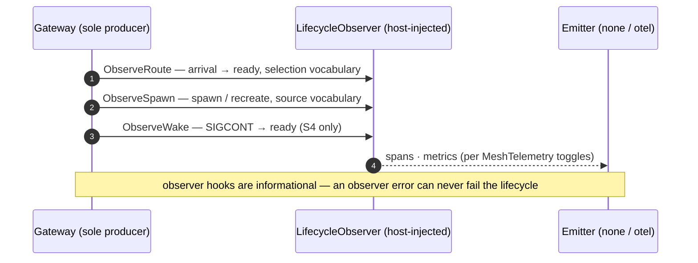

The appendix collects the contracts and reference material that serve more
than one guide: the lifecycle-event schema every emitter implements, the
vocabulary the docs use, and the CI posture that keeps the module honest.

## Lifecycle events

The gateway is the **sole producer** of lifecycle events, reported through
the host-pluggable `mesh.LifecycleObserver` interface — never a telemetry
SDK (the extraction contract). The events are transport-agnostic: identity,
bounded-vocabulary fields, and timings. That is what makes a second emitter
possible without touching the gateway.

### `RouteEvent` — `ObserveRoute`

One routing decision: A2A arrival → process-ready (the recreate-SLO window).
The context carries the dispatch's trace context so an emitter can parent
the event to the run's trace.

| Field | Type | Vocabulary / notes |
| ----- | ---- | ------------------ |
| `Team`, `Role`, `Pod`, `EndpointID` | string | Bounded routing identity (span attributes / metric labels). |
| `Selection` | `RouteSelection` | `idle` \| `overflow` \| `wake`. `overflow` = recreated from the envelope for this request; `wake` = hibernated process woken (S4 only). |
| `Duration` | duration | Arrival → ready wall-clock. |
| `Err` | error | Non-nil when the route failed (outcome: `success` \| `error`). |

### `SpawnEvent` — `ObserveSpawn`

One spawn or recreate with wall-clock duration. On the recreate path the
context is the triggering route's, so an emitter can nest it under the route.

| Field | Type | Vocabulary / notes |
| ----- | ---- | ------------------ |
| `Team`, `Role`, `Pod`, `EndpointID` | string | Bounded routing identity. |
| `Source` | `SpawnSource` | `envelope` (recreate — the ≤3 s target path) \| `cold` (pool boot). |
| `Duration` | duration | Spawn wall-clock. |
| `Err` | error | Non-nil when the spawn failed. |

### `WakeEvent` — `ObserveWake`

One hibernation wake (S4): SIGCONT → ready.

| Field | Type | Vocabulary / notes |
| ----- | ---- | ------------------ |
| `Team`, `Role`, `Pod`, `EndpointID` | string | Bounded routing identity. |
| `Duration` | duration | Wake wall-clock. Zero on a rebind wake — its cost is the respawn, already reported as a spawn with `Source=envelope`. |
| `Rebind` | bool | `true` when the envelope's model moved while the process slept and the wake respawned from the current envelope (rebind-at-wake, never mid-stream). |
| `Err` | error | Non-nil when the wake failed. |

### Hibernation has no event — by design

There is deliberately **no `ObserveHibernate` hook**. The interface is
lifted, not extended: hibernation signals ride the existing surface —
entry/exit of the hibernated tier shows in the process-state gauge
(`active` \| `idle` \| `hibernated` \| `stopped`), a wake-served route shows
as `RouteEvent{Selection=wake}` plus the `WakeEvent`, and the RAM-reclaim
trade shows as a `SpawnEvent{Source=envelope}` recreate (the
"had-to-recreate" / hibernate-miss signal).

### The process-state gauge

Emitters poll `ProcessStateSnapshot` on their own cadence. The rules: cheap
and non-blocking (an in-memory listing, never a live call into a process);
stopped slots stay counted (recreate-on-demand capacity, not a leak);
zero-count states may be omitted.

### Cardinality firewall

Every label an emitter derives is bounded: identity is the pool set
`{team, role}` (plus `pod` where the host spine already carries it), state
is the fixed four-value enum, spawn source is a two-value set. Endpoint ids
and run ids are attributes only — never metric labels.

### Emitters

| Emitter | Status |
| ------- | ------ |
| `otel` — the host's OTel spine (reference host: `meshobs`; `mesh.route`/`mesh.spawn`/`mesh.wake` spans, ready-latency / spawn-latency / wake-latency / hibernate hit-miss metrics, process gauge) | Live. |
| `nats` — JetStream emitter, five-event lifecycle set | Reserved — deliberately deferred until the event schema proves out. |

Adding an emitter means implementing `mesh.LifecycleObserver` (optionally a
gauge over `ProcessStateSnapshot`) and injecting it at the composition root —
no gateway change, no telemetry SDK in the module. The `MeshTelemetry` CRD's
`emitter: none|otel` selects and toggles the posture declaratively (see the
[CRD reference](/docs/crd-reference/)).

## Glossary

| Term | Meaning |
| ---- | ------- |
| **A2A** | The task wire the mesh serves: a `Task` in, a stream of typed `Event`s out (`status`, `message`, `tool`, `usage`, …). |
| **Envelope** | The pre-loaded standing identity of a process (runtime type, model, skills) — and, per task, the transported context (system context + work instruction) a CLI consumes. |
| **Gateway** | The pod hosting a standing band; serves the A2A `/task` entrypoint and manages per-slot supervisor processes. |
| **Host** | A platform adopting the mesh (host #1: k8squad). Hosts plug in as policy — scheduling, identity, telemetry spine, memory stay host-side. |
| **Hibernation (S4)** | Parking a long-idle process with SIGSTOP so its RAM is reclaimed; woken with SIGCONT on demand. |
| **Lifecycle observer** | The host-pluggable emitter interface over route/spawn/wake events (`mesh.LifecycleObserver`). |
| **MeshRoute** | The routing/selection policy object: pick strategy, recreate SLO, fallback behavior. |
| **MeshPool** | The standing-process pool contract: envelope, standing band, saturation, lifecycle knobs, registration heartbeat/TTL. |
| **MeshTelemetry** | The declarative on/off + sink selector over the lifecycle-event contract (`emitter: none\|otel`). |
| **Recreate** | Rebuilding a process from the pool's envelope without losing identity — endpoint id, registration, and memory references come back. Target: ≤3 s arrival → ready. |
| **RuntimeAdapter** | The 7-op contract every runtime plugs into: `Spawn`, `Register`, `Route`, `Hibernate`, `Wake`, `Stop`, `Recreate`. |
| **Saturation** | The busy-everywhere condition; the overflow policy grows the band or rejects with `ErrNoIdleProcess`. |
| **Standing band** | The min/max process count a pool holds — min is the floor, max the saturation ceiling. |
| **Standing agent** | A registered, long-lived team member whose *process* is individually ephemeral. |
| **Toolchain layering** | Copying the pinned CLI substrate onto a pod via initContainer and prepending it to `PATH`. |
| **Wake** | SIGCONT on a hibernated process when a route selects it; a model drift forces an envelope respawn (rebind). |

## CI and branch protection

### The module (K8sAgentMesh)

Every PR to `main` runs the required checks — the branch-protection rule on
`main` enforces exactly this set:

| Check | Enforces |
| ----- | -------- |
| `build` | `go build ./...` + `go vet ./...` |
| `unit` | Unit tests with the race detector |
| `quality` | golangci-lint, gofmt, `go mod tidy` zero-dependency guard |
| `guards` | **Extraction-clean** (no `github.com/K8squad/K8squad/*` import anywhere) + **CRD structural validation** (every CRD spec property cross-checked against the Go types' JSON tags) |
| `coverage` | Soft gate: warn <70%, fail <50% |
| `dco` | `Signed-off-by:` trailer on every PR commit |
| `security-code` | govulncheck + CodeQL (Go) |
| `security-deps` | Dependency review on PR dependency diffs |
| `sbom-cve` | Syft SBOM + Grype scan, fail on Critical |

Two more jobs self-activate on artifacts: `docker` (multi-arch build, scan,
conditional GHCR push — active) and `helm`/`functional` (skip cleanly until
their artifacts land). DCO is enforced by trailer, not GPG — do not enable
"require signed commits".

The two guards worth knowing as a contributor: **extraction-clean** keeps the
module free of host imports, and **crd-structural-validate** means the CRD
YAML on this site can never silently drift from the Go types — the
[field reference above](/docs/crd-reference/) is cross-checked by the same
script the module runs.

### This website (k8sAgentsMesh-website)

CI on every PR runs the Astro build plus the **docs-sync check**
(`scripts/check-docs-sync.mjs`): the module-surface claims this site makes —
packages, CRD kinds, adapter ops, seams, release tags — are verified against
the live main repo, driven by `src/data/main-repo-facts.json`. If the module
moves, the site's build fails until either the docs or the facts file is
updated. Claims on these pages are checkable by design.
