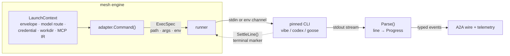

K8sAgentMesh is **runtime-agnostic**: a coding-agent CLI plugs in through a
small declarative contract, and the mesh engine owns everything else — process
execution, the A2A task lifecycle, sequencing, and telemetry. Adding a runtime
is one new file plus a `Register` call: zero core change.

This section covers the contract itself, how the pinned CLI toolchains are
layered onto pods, and one page per supported runtime:

- [vibe](/docs/runtimes/vibe/) — Mistral's headless coding agent
- [codex](/docs/runtimes/codex/) — OpenAI's official Rust coding agent
- [goose](/docs/runtimes/goose/) — the goose coding agent (aaif-goose/goose)

## The engine contract

An adapter (`agentruntime/` package) implements the `Runtime` interface —
declarative and pure, no I/O and no logging:

| Method | Returns | What it is |
| ------ | ------- | ---------- |
| `Type()` | string | The runtime flavor (`vibe`, `codex`, `goose`). |
| `CLIVersion()` | string | The pinned CLI revision the adapter targets (ADR-017 reproducibility). Advertised on the Agent Card. |
| `Capabilities()` | `a2a.Capabilities` | The honest capability set — streaming, tool calls, BYO model endpoint, artifact kinds. A gap is advertised, never discovered as a mid-run failure. |
| `DefaultModel()` | `a2a.ModelInfo` | Default model id + its context-window budget authority. The envelope's model overrides the id, never the window. |
| `CredentialShape()` | `CredentialShape` | How the generic per-user credential maps into runtime-native env (`api-key` for all three current engines). |
| `Command(lc)` | `ExecSpec` | Turns one task's `LaunchContext` into the native process: path, args, env, stdin, workdir files. |

Because adapters are pure, their capability claims are asserted by unit tests
and the conformance suite — the engine can trust the card.

## What one task looks like



The envelope — system context plus the concrete work instruction — reaches the
CLI through **stdin or env, never argv**, so the prompt cannot leak through the
process table. Large system contexts spill to a workdir file (only the path
rides the env), keeping exec clear of the kernel's per-env-string ceiling.
Each adapter decodes its CLI's native stdout stream into typed `Progress`
events (messages, tool calls, usage), so activity reaches the A2A wire and the
telemetry spine as structured events instead of opaque text.

## Toolchain layering and PATH

The supervisor images (`mesh-gateway`, `agentruntime`) stay small; the pinned
CLI substrates are separate images layered on by the chart's initContainer:

| Toolchain image | Contents |
| --------------- | -------- |
| `toolchain-vibe` | uv/Python substrate, `mistral-vibe==2.9.6` |
| `toolchain-codex` | Node substrate, `@openai/codex@0.152.0` + the vendored `mesh-codex-exec` wrapper |

The initContainer copies the CLI tree onto an `emptyDir`
(`/toolchain/.local` for the uv install, `/toolchain/usr-local` for the npm
one), and the Deployment prepends both to `PATH`:

```text
/toolchain/.local/bin:/toolchain/usr-local/bin:/usr/local/sbin:/usr/local/bin:/usr/sbin:/usr/bin:/sbin:/bin
```

Without that amendment the spawned `vibe` / `mesh-codex-exec` binaries would
not resolve. The chart picks the repository default by flavor —
`runtimeType: vibe` → `toolchain-vibe`, `runtimeType: codex` →
`toolchain-codex` — overridable with `*.toolchain.image.repository`.

## Credentials

The chart projects an existing Secret into the runtime-native env var; raw
credentials never appear in values:

| Runtime | Env var | Secret key (chart default) |
| ------- | ------- | --------------------------- |
| vibe | `MISTRAL_API_KEY` | `mistral-api-key` |
| codex | `OPENAI_API_KEY` | `openai-api-key` |
| goose | `OPENAI_API_KEY` | `openai-api-key` |

```yaml
agentruntime:
  runtimeType: vibe
  credentials:
    existingSecret: mesh-vibe-credentials
```

Adapters map the credential and any BYO model route onto exactly one env var
per lane — emitting both would shadow the route token (first-wins getenv).

## BYO model endpoints

Every adapter supports a bring-your-own OpenAI-compatible endpoint — the
shared-LAN Ollama lane is the reference case. A route carries its own base
URL, model id, and optional token; a zero-token route uses the conventional
`ollama` placeholder key so the client library still authenticates. See each
runtime page for its env mapping.

## MCP

MCP servers are projected as an intermediate representation — name, transport
(`stdio` or `streamable-http`), args/URL, allow/deny tool sets, and credential
**names**, never material. Each adapter renders the IR into its native config
at start: codex gets a rendered `config.toml` (`[mcp_servers.*]`) with no
credential material in it — credentials ride the process environment
(env-var names carried in the IR's `envNames`). The full
renderer suite for the other runtimes stays host-side until it is upstreamed.

## Worked example

From the [quickstart](/docs/quickstart/)'s kind cluster, switch the deployed
supervisor from the default vibe lane to codex:

```yaml
# values-codex.yaml
agentruntime:
  runtimeType: codex
  credentials:
    existingSecret: mesh-codex-credentials
    openaiApiKeyKey: openai-api-key
```

```sh
kubectl -n mesh create secret generic mesh-codex-credentials \
  --from-literal=openai-api-key=sk-...

helm upgrade mesh ./deploy/helm/k8sagentmesh -n mesh -f values-codex.yaml --wait
```

The deployment swaps its toolchain initContainer to `toolchain-codex`, projects
the Secret as `OPENAI_API_KEY`, and every subsequent `POST /task` drives the
pinned codex CLI — no other change. The per-runtime pages walk each adapter's
pins, env contract, and event mapping in detail.
